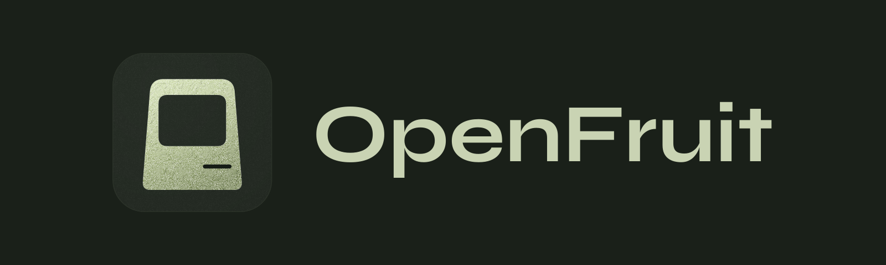
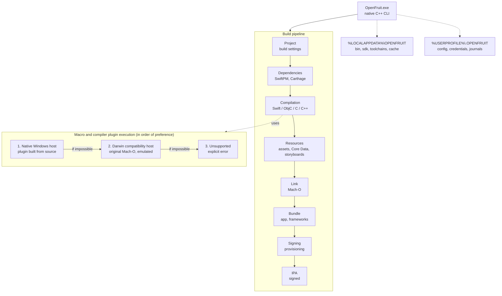

<p align="center">
  
</p>

[](https://github.com/ssilvestri15/openfruit/actions/workflows/build-openfruit-core.yml)
[](LICENSE)

Hi everyone!

I want to share two projects I've been working on: **OpenFruit and OpenFruit Studio**. But before talking about the products themselves, I'd like to share why I started these projects.

With AI, we can bring countless ideas to life, recreate complex software, and do things that were once unimaginable. But I believe people still need to learn, to stay curious, to understand how things work and how to make them work.

Often, that curiosity comes from people younger than us, who might have limited access to premium hardware, advanced AI models, or simply be too young to justify such a big expense to their parents.

That's why I want to **democratize knowledge and make iOS app development accessible to everyone. On Windows. For free.**

I believe it's important for us, as computer scientists, to leverage AI not just to build things, but also to share valuable knowledge and make technology more accessible.

This is my attempt to contribute to that vision.

**Knowledge belongs to everyone. Always. And it should always be accessible.**

Now, let's talk about the projects.

---

- **OpenFruit** is an experimental, open-source toolchain that brings iOS compilation workflows to Windows, including Swift, Objective-C, SwiftPM, Mach-O linking, and IPA packaging.
- **[OpenFruit Studio](https://github.com/ssilvestri15/openfruit-studio)** is a new IDE built on top of OpenFruit, designed to make iOS development accessible to everyone, especially those who want to experiment, write code themselves, and learn how software really works. 

### OpenFruit - The Engine

OpenFruit is written primarily in C++ and aims to build iOS applications directly on Windows, without requiring a Mac.

Its architecture is divided into independent components responsible for project analysis, SDK management, dependency resolution, compilation, linking, packaging, and signing.

Instead of creating a completely new development ecosystem, OpenFruit aims to work with existing Apple technologies, including Xcode projects, Swift, Objective-C, and Apple's original SDKs.

**What makes it interesting?**

- **Native Windows execution:** The goal is to run the entire build pipeline directly on Windows, without relying on macOS, WSL, or virtualization.
- **Existing project compatibility:** OpenFruit is designed to understand existing Xcode projects, their targets, configurations, and dependencies.
- **Modular architecture:** Components are separated to make the system easier to maintain, extend, and debug.
- **Performance:** Written in C++, with incremental builds, dependency caching, and reusable build artifacts.
- **Transparency:** The project aims to preserve the original behavior of Apple's development tools and provide detailed diagnostics throughout the compilation process.
- **Storyboards:** We added a new module called OpenIB that can build storyboards. It's still experimental.

**What's working so far?**

OpenFruit can already compile controlled Swift projects for iOS ARM64, generate Mach-O binaries, resolve SwiftPM dependencies, produce IPA packages directly on Windows, and install them on a connected iPhone.

It has been tested with 5 iOS apps so far:

- **CampUS**: my private app, written entirely in SwiftUI. A simple and small app; it has been compiled successfully.
- **[Delta](https://github.com/rileytestut/Delta)**: an emulator for iOS; it has been compiled successfully, installed and launched on an iPhone.
- **[VLC for iOS](https://github.com/videolan/vlc-ios)**: the VLC media player; it has been compiled successfully, installed and launched on an iPhone.
- **[Swiftfin](https://github.com/jellyfin/Swiftfin)**: a client for Jellyfin; it has been compiled successfully and launched on an iPhone.
- **[Nextcloud](https://github.com/nextcloud/ios)**: the most difficult app tested so far, a mix of SwiftUI and storyboards; it has been compiled successfully, installed and launched on an iPhone.

**How is it structured?**

A single native CLI (`OpenFruit.exe`) drives the whole pipeline. Installed tools live under `%LOCALAPPDATA%\OPENFRUIT`; user configuration and credentials live under `%USERPROFILE%\.OPENFRUIT`.



The engine is split into libraries that each own one stage: project interpretation (Xcode `.pbxproj` and `.xcconfig`), the package engine, the compiler proxy, resource compilers (including OpenIB), the build driver, and packaging/signing. A project is never patched to fit OpenFruit; the build environment adapts to the project.

**What are the limitations?**

OpenFruit is still experimental.

Complex applications can expose compatibility issues, some Apple tooling and macro workflows are not yet fully supported natively, and signing and deployment still require further validation.

Known limitations today:

- **iOS only.** watchOS and visionOS targets and assets are not built.
- **Signing happens during `build`.** There is no separate command to re-sign an existing IPA.
- **App extensions need a matching profile.** Extensions whose bundle identifiers the provisioning profile does not authorize are removed from the signed app. With a single development profile, most extensions are therefore left out.
- **Some SwiftPM package resources are not built yet.** `.xcstrings` catalogs are compiled; other resources that SwiftPM leaves to the build system (for example an `Assets.xcassets` inside a package) are not.
- **Icon Composer icons (`.icon`) are flattened.** Background, layers, opacity, scale and solid tints are composed into a single image; Liquid Glass effects are not rendered, and properties without an exact flattened rendering (automatic fills, moved layers, blend modes) stop the build with an explicit error.
- **Swift 4 packages.** App targets in a pre-Swift-5 language mode are built without explicit modules and compilation caching, as Xcode does. SwiftPM packages do not apply that rule per target yet, so a package that still builds in Swift 4 mode can fail on Apple SDK interfaces.
- **App groups and other team-specific capabilities** can only be provisioned by the team that owns them. An app may build and sign, then fail at launch without them.
- **Windows-specific file names.** A repository that relies on a name Windows cannot represent (for example one ending in a dot) can show as modified after checkout.

The biggest challenge is not simply producing an IPA. It's reproducing the behavior of a complex development ecosystem while preserving compatibility with Apple's original technologies.

And that's exactly what makes this project interesting.

### What's next?

There is still a lot of work ahead.

OpenFruit needs broader compatibility, stronger integration tests, and a reliable installation experience. OpenFruit Studio needs to turn those technical capabilities into an intuitive development environment.

**A Linux version of OpenFruit is planned.** Today OpenFruit runs on Windows only.

Neither project is production-ready, and I don't want to pretend otherwise.

But I believe that **making technology accessible doesn't mean making it simple internally. It means taking on that complexity so others don't have to.**

My goal isn't to replace Apple or compete with Xcode overnight.

It's to give more people the opportunity to learn, experiment, and create, without expensive hardware being the first obstacle.

**Both projects are open to feedback, ideas, and contributions.**

And if even one young developer manages to build their first iOS application on a Windows computer because of these projects, I will consider that a meaningful success.

---

## Getting started

**Requirements:** Windows 10 or 11 (x64), Git for Windows, Visual Studio Build Tools with C++ and CMake (only to build OpenFruit from source), and the Apple Devices app or iTunes to install apps on an iPhone over USB. The Swift toolchain and LLVM are installed by `openfruit bootstrap`; the iOS SDK is downloaded from Apple with your own Apple Developer account the first time a build needs it.

```powershell
git clone https://github.com/ssilvestri15/openfruit.git
cd openfruit
.\openfruit\windows\build.ps1 -WithTests
openfruit bootstrap
```

Build an app, then install it on a connected iPhone:

```powershell
openfruit build C:\path\to\MyApp.xcodeproj --scheme MyApp
openfruit devices
openfruit device install C:\path\to\MyApp-signed.ipa --udid <UDID>
```

`openfruit --help` lists every command. Environment variables are documented in [docs/ENVIRONMENT.md](docs/ENVIRONMENT.md).

Xcode, the iOS SDK and Apple's compiler plugins are Apple software: OpenFruit does not redistribute them, each user obtains them with their own Apple account. See [Trademarks and disclaimer](#trademarks-and-disclaimer).

## Let an agent do it

Using an AI coding agent (Claude Code, Codex, Cursor, …)? Copy one of these prompts. Replace the parts in `<angle brackets>`.

**Install OpenFruit**

```text
Install OpenFruit on this Windows PC from https://github.com/ssilvestri15/openfruit.
Clone the repository, read its README, then run .\openfruit\windows\build.ps1 -WithTests
and `openfruit bootstrap`. Verify the installation with `openfruit doctor` and
`openfruit --version`, and tell me which prerequisites are still missing.
If an Apple sign-in is required, open it and let me log in myself: never type my
Apple ID, passwords or certificate passwords.
```

**Create an app and build it with OpenFruit**

```text
Create an iOS app that <describe what the app should do>, written in Swift and SwiftUI.
Create it as an Xcode project (.xcodeproj) with a single iOS application target.
Build it with OpenFruit (https://github.com/ssilvestri15/openfruit; the CLI is
%LOCALAPPDATA%\OPENFRUIT\bin\openfruit.exe, run `openfruit --help` to see the commands):
openfruit build <path to the .xcodeproj> --scheme <app name> --diagnostics=json
Read the diagnostics, fix my app's code until the build succeeds and give me the path
of the signed IPA. Change only the app's code, never OpenFruit, and do not handle my
Apple credentials.
```

**Clone an existing app and build it**

```text
Clone <GitHub URL of an iOS app> and build it with OpenFruit
(https://github.com/ssilvestri15/openfruit; CLI: %LOCALAPPDATA%\OPENFRUIT\bin\openfruit.exe).
Find the .xcworkspace or .xcodeproj and the app's scheme, then run
openfruit build <path to the workspace or project> --scheme <scheme> --rebind-bundle-id --diagnostics=json
Do not modify the cloned project: if the build fails, report the first error and
which file or dependency it comes from. If it succeeds, list the connected devices
with `openfruit devices` and install the IPA with `openfruit device install <ipa> --udid <UDID>`.
```

## Trademarks and disclaimer

**Trademarks.** Apple, the Apple logo, iPhone, iPad, iOS, iPadOS, macOS, Xcode, Swift, SwiftUI, App Store and TestFlight are trademarks of Apple Inc., registered in the U.S. and other countries and regions. All other product and company names mentioned in this repository (including Delta, VLC, Swiftfin, Jellyfin and Nextcloud) are trademarks or registered trademarks of their respective owners. They are used only to identify the corresponding products and the projects tested for compatibility. OpenFruit and OpenFruit Studio are independent projects and are not affiliated with, endorsed, sponsored or approved by Apple Inc. or by any other owner of the trademarks mentioned.

**Apple software.** OpenFruit does not include or redistribute Xcode, the iOS SDK, Apple's compiler plugins or any other Apple software. Users obtain them with their own Apple account and are solely responsible for complying with the license agreements that govern them (including the Xcode and Apple SDKs Agreement and the Apple Developer Program License Agreement), with Apple's terms for code signing and device installation, and with the licenses of the third-party projects they build.

**No warranty, limitation of liability.** The software is provided "as is", without warranty of any kind, express or implied, including but not limited to the warranties of merchantability, fitness for a particular purpose and non-infringement, as also stated in the GNU General Public License. To the maximum extent permitted by applicable law, the authors and contributors are not liable for any claim, damage or other liability arising from the use of the software or from the applications built, signed or installed with it, including loss of data, damage to devices, suspension or termination of Apple accounts or developer memberships, or legal consequences of using Apple software. Use it at your own risk.

## License

OpenFruit is free software, licensed under the GNU General Public License, version 2 or (at your option) any later version. See [LICENSE](LICENSE). Distributed binaries include Unicorn (GPL-2.0) and are therefore covered by version 2 of the GPL as a whole. Third-party components and their licenses are listed in [THIRD_PARTY_NOTICES.md](THIRD_PARTY_NOTICES.md). Apps you build with OpenFruit are not covered by its license.

## Charity

If OpenFruit creates commercial value for you, we ask you to donate part of it to Save the Children or to a scientific institute conducting medical research, preferably in Southern Italy. It is a request, not a condition of the license: see [CHARITY.md](CHARITY.md).

## Contributing

Contributions are welcome. Please read [CONTRIBUTING.md](CONTRIBUTING.md): every contribution requires accepting the [Contributor License Agreement](CLA.md).

Made with ❤️ by Simone and his friend AI 🤖
