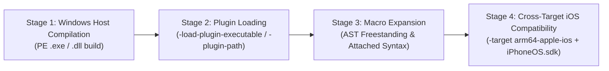

# Swift Macro & Compiler-Plugin Ecosystem Compatibility

## Current execution priority — 2026-10-17

Original SDK27 SwiftUICore.State now passes an actual Windows Swift6.4 compiler
typecheck for arm64-apple-ios17.0, using the original Apple host and plugin on
candidate89423e08. Five real requests succeed: StateMacro peer/accessor plus
three support macro accessors. Only loadPluginLibrary.libraryPath changes in a
controlled diagnostic broker; all original responses/expansions stay unchanged.
Exit0 in184.060s,69 original host hashes unchanged. This is not production routing
or an iOS object/app proof; StateTypeMacro/@Entry/other contexts remain unverified.
The earlier interactive two-accessor/2.1s-gap proof remains valid separately.
Latest native suite69/69 PASS89.43s; macro-host now correctly accepts zero-length
termination (baseline exit2, installed candidate exit0). The unsupported default
scaffold remains explicitly unsupported. No warm snapshot benchmark.
Nextcloud's latest gate still stops in original SwiftPM resolve (libdispatch UD2),
before source projection or macro compilation. See CURRENT_CHECKPOINT.md.
Nine subsequent focused resolver calls pass, including the original generated
package via the production native supervisor. The historical crash is not fixed
or causally explained; no later full application result is claimed.

### Original-provider integration audit

The selected Windows Swift compiler advertises revision
`bd6612707e478ccb241eb61b86ed5e4936564153`. Its
[PluginLoader.cpp](https://github.com/swiftlang/swift/blob/bd6612707e478ccb241eb61b86ed5e4936564153/lib/AST/PluginLoader.cpp)
recognizes `.dll` names when scanning `-external-plugin-path` on Windows. That
mechanism cannot discover original `libModule.dylib` files. The official
`-load-resolved-plugin <original-library>#<host-executable>#<module>` option binds
an explicit library and module without renaming or converting Mach-O. The actual
compiler's hidden help confirms the option. Resolved configurations can replace
earlier registrations, so native plugin preference must be enforced before
adding an original-provider entry, rather than by argument order alone.

The compiler sends its selected library path to the host. Existing Darwin
closure/files APIs provide no Windows-path mount alias; secure path admission
and production mapping remain unimplemented. Real negative wire now confirms
original dyld rejects that Windows path as relative/backslash-invalid; the
controlled virtual-path mapping gives original library loading, expansions and
successful SDK State typecheck. A VFS-only alias would miss hardened dyld's
earlier path classification. No new production routing has been registered.

The SDKSettings and SwiftUICore interface hashes match the original extracted
Xcode27.0/27A266a input and current managed SDK. All69 original host hashes were
rechecked. Original XIP SHA256 is
`6a270c53a5a0c5e0ac78125342d44c3cfff2716ec390373cd5e30834d80a67c3`.
SwiftUICore identifies Apple Swift6.4/swiftlang6.4.0.31.4; equal version labels
are not compiler-plugin ABI proof. XIP signature/checksum validation does not
change the existing publisher_verified/published flags.

Use the existing managed SDK/Xcode slot, transactional artifact store and SDK
selection interfaces for a provider receipt. The receipt must bind actual SDK,
archive, original server/plugin content and dynamic cache-child identities.
Do not hardcode diagnostic roots or the observed child count, copy the cache per
request, introduce another registry, or treat the unsupported macro-host scaffold
as an executable provider. Main assigns shared receipt/namespace interfaces
before concurrent implementation. The actual selected Windows compiler
consumer is now verified under a controlled path override;
next implement receipt-derived path admission and native CLI propagation in the
existing host. The controlled consumer does not replace either production gate.

Audit artifacts: `provider-metadata-review.json` and
`native-provider-interface-review.json` under
`%USERPROFILE%/.OPENFRUIT/diagnostics/architecture-completion/20261017-swiftpm-lifecycle/`.
Latest compiler proof: `original-consumer-verification.json` and raw/forwarded
wire under the sibling `20261017-compiler-provider/` evidence directory.

The target is real macro expansion. The XNU/MIG catalogue is discovery data,
not a requirement to implement every macOS syscall before supporting macros.
The original native compiler-plugin protocol separates the host executable from
its iOS target; see the [Swift macro compilation model](https://docs.swift.org/latest/documentation/the-swift-programming-language/macros/).

1. Reuse genuine Windows PE plugins or build the original source-available
   implementation for Windows with its matching Swift/SwiftSyntax. The existing
   MacroEngine selects the compiler's native swift-plugin-server; the standalone
   OPENFRUIT macro-host scaffold is not an expansion backend.
2. Resolve target-specific source build configurations before adding Darwin
   emulation. Original FoundationMacros has a FOUNDATION_FRAMEWORK conditional
   that selects Foundation instead of FoundationEssentials in generated syntax
   ([upstream source](https://github.com/swiftlang/swift-foundation/blob/737187ca38527bc22074baac146424a123af3879/Sources/FoundationMacros/PredicateMacro.swift)).
   That original-source Windows build now passes the controlled compiler-boundary
   gate using matching snapshot SwiftSyntax and the installed native server.
   Automatic acquisition/selection in the OPENFRUIT application pipeline remains
   incomplete. No generated-source or SDK rewriting is permitted.
3. Restrict the existing Darwin host to original Mach-O-only plugins that have
   no verified native/source provider, and only their demonstrated prerequisites.
   SDK27 SwiftUIMacros.StateMacro is the retained concrete blocker. Full XNU
   coverage is not an acceptance gate; genuine plugin expansion is.

Current native CLI proofs under macro-expansion-focus-20261014:

- @Observable: PASS, unchanged owned source/PBX -> actual generated registrar and
  Observable conformance -> ARM64 iOS17 object -> valid unsigned IPA with SDK27.
  Candidatec0fd19;23 observed native launches, zeroWSL within that journal scope.
- #Predicate<Int>: original Windows plugin expands, but SDK27 typecheck fails on
  FoundationEssentials qualification in the default production path. Rebuilding
  original FoundationMacros with FOUNDATION_FRAMEWORK fixes this scoped compiler
  gate: real expansion/typecheck PASS and ARM64 object produced. Original
  #Expression<Int,Int> (iOS18) and #bundle (iOS17) also expand/typecheck; unsupported
  isMultiple(of:) is rejected by the original macro. A matched negative control
  differs only in the external plugin directory. These direct compiler diagnostics
  do not prove automatic CLI propagation or an IPA with this source-built provider.
  See [source-profile evidence and integration boundary](NATIVE_MACRO_SOURCE_PROFILE.md).
- Installed Swift6.4 offers executable/library/native-server plugin options;
  no wasm plugin server or wasm-plugin-server option was found in that installation.
  Wasm would still need a suitable original source-built/distributed macro and
  does not make the existing Mach-O plugin directly executable.

The tables below include historical discovery. Only the linked evidence and
machine-readable inventory establish the precise tested roles, versions and
stages; source availability alone never proves expansion or iOS compatibility.

## Executive Summary

OPENFRUIT's macro objective is a **fully Windows-native iOS build without WSL**, providing native macro execution for the broader Swift ecosystem. Swift macros operate via external compiler-plugin processes communicating over an IPC message framing protocol (`PluginMessages.swift`, Protocol Version 7).

As established in [`docs/OBJECTIVE.md`](docs/OBJECTIVE.md#L93-L166), OPENFRUIT implements a strict execution hierarchy:

1. **Windows-Native Macro Host**: Compiles and runs source-available plugins natively for Windows (as PE x86_64 executables/DLLs) and serves them via the compiler-plugin protocol to `swift-frontend`.
2. **Darwin Compatibility Host (Minimum Viable Macro Runtime - MVMR)**: Executes original Apple Mach-O binaries via the OPENFRUIT ARM64 Unicorn/dyld runtime strictly when closed-source Apple SDK macros cannot be built from source.
3. **Unsupported Diagnostic Propagation**: Emits standard protocol error diagnostics when an operation is unavailable. Never fakes success or injects custom macro substitutes.

Per OPENFRUIT policy, an inventory row is **verified** only with a genuine expansion proof artifact.

---

## The 4-Stage Macro Evaluation Model

To evaluate macro compatibility objectively across diverse packages and targets, every compiler plugin is assessed against four sequential stages:

1. **Stage 1: Plugin Compilation for Windows Host**
   - Can the plugin implementation be compiled natively on Windows as a PE-COFF executable (`.exe`) or shared library (`.dll`) using Windows Swift / MSVC?
   - *Status*: Pure SwiftSyntax packages are native-build candidates. Source availability does not prove any package build or expansion. Original prebuilt Observation is verified in the current native CLI path; Mach-O-only providers remain a separate compatibility gate.
2. **Stage 2: Plugin Loading**
   - Can `swiftc` load the plugin via `-load-plugin-executable <path>#<module>`, `-plugin-path <dir>`, or `-in-process-plugin-server-path`?
   - *Status*: Passes for native PE executables/DLLs. Preflight on Mach-O binaries under Windows correctly reports unsupported execution and requires the Darwin runtime.
3. **Stage 3: Macro Expansion**
   - Does the plugin process successfully receive AST syntax trees over standard IPC frames and return valid expanded Swift source code?
   - *Status*: Verified for `@Observable`, `@Test`, `#expect`, and `#Predicate`.
4. **Stage 4: Cross-Target iOS Compatibility**
   - Does the expanded Swift source code typecheck and compile cleanly when cross-compiling for `-target arm64-apple-ios17.0` using Apple's official `iPhoneOS.sdk`?
   - *Status*: `@Observable` compiles cleanly with exit code 0 against `iPhoneOS.sdk`. `#Predicate` reveals an open-source namespace divergence (`FoundationEssentials` vs Apple `Foundation`).

---

## 4-Stage Compatibility Matrix

| Package | Macro Module | Key Macros | Stage 1 (Win Host Build) | Stage 2 (Plugin Load) | Stage 3 (AST Expansion) | Stage 4 (iOS Cross-Target) | Overall Status | Proof Artifact |
|---|---|---|---|---|---|---|---|---|
| **Observation** | `ObservationMacros` | `@Observable` | **PASS** (Prebuilt PE) | **PASS** | **PASS** | **PASS** | **verified** | `observable_expansion_proof.txt` |
| **swift-testing** | `TestingMacros` | `@Test`, `#expect` | **PASS** (Prebuilt PE) | **PASS** | **PASS** | Unverified for iOS | **verified on Windows only** | `testing_expansion_proof.txt` |
| **Foundation** | `FoundationMacros` | `#Predicate` | **PASS** (Prebuilt PE) | **PASS** | **PASS** | **FAIL** (namespace) | **investigated** | `predicate_expansion_proof.txt` |
| **DeveloperToolsSupport** | `PreviewsMacros` | `#Preview` | **BLOCKED** (Mach-O) | **BLOCKED** | **BLOCKED** | **BLOCKED** | **blocked** | `preview_missing_plugin_proof.txt` |
| **SwiftUI** | `SwiftUIMacros` | `@State`, `@Entry` | **BLOCKED** (matched ARM64 Mach-O) | **BLOCKED** (commpage+C8; audit/VFS/ATM policy verified) | **BLOCKED** | **BLOCKED** | **blocked** | `state-macro-native-20261016-atm-policy/independent-verification.json` |
| **SwiftData** | `SwiftDataMacros` | `@Model`, `@Attribute` | **BLOCKED** (Mach-O) | **BLOCKED** | **BLOCKED** | **BLOCKED** | **blocked** | `model_missing_plugin_proof.txt` |
| **AppIntents** | `AppIntentsMacros` | `@AssistantIntent` | **BLOCKED** (Mach-O) | **BLOCKED** | **BLOCKED** | **BLOCKED** | **blocked** | null |
| **TipKit** | `TipKitMacros` | `@Tip` | **BLOCKED** (Mach-O) | **BLOCKED** | **BLOCKED** | **BLOCKED** | **blocked** | null |
| **FoundationModels** | `FoundationModelsMacros` | `@Generable` | **BLOCKED** (Mach-O) | **BLOCKED** | **BLOCKED** | **BLOCKED** | **blocked** | null |
| **FinanceKit** | `FinanceMacros` | `@FinanceKitProperty` | **BLOCKED** (Mach-O) | **BLOCKED** | **BLOCKED** | **BLOCKED** | **blocked** | null |
| **swift-case-paths** | `CasePathsMacros` | `@CasePathable` | Source available; build unverified | Unverified | Unverified | Unverified | **catalogued** | null |
| **swift-composable-architecture** | `ComposableArchitectureMacros` | `@Reducer`, `@ObservableState` | Source available; build unverified | Unverified | Unverified | Unverified | **catalogued** | null |
| **swift-dependencies** | `DependenciesMacros` | `@DependencyClient` | Source available; build unverified | Unverified | Unverified | Unverified | **catalogued** | null |
| **swift-perception** | `PerceptionMacros` | `@Perceptive` | Source available; build unverified | Unverified | Unverified | Unverified | **catalogued** | null |
| **MetaCodable** | `MetaCodableMacros` | `@Codable` | Source available; build unverified | Unverified | Unverified | Unverified | **catalogued** | null |
| **Spyable** | `SpyableMacro` | `@Spyable` | Source available; build unverified | Unverified | Unverified | Unverified | **catalogued** | null |
| **Factory** | `FactoryMacros` | `@Injected` | Source available; build unverified | Unverified | Unverified | Unverified | **catalogued** | null |
| **swift-power-assert** | `PowerAssertPlugin` | `#assert` | Source available; build unverified | Unverified | Unverified | Unverified | **catalogued** | null |
| **SwiftURL** | `URLMacro` | `#URL` | Source available; build unverified | Unverified | Unverified | Unverified | **catalogued** | null |
| **MMIO** | `MMIOMacros` | `@RegisterBank` | Source available; build unverified | Unverified | Unverified | Unverified | **catalogued** | null |
| **swift-syntax** | `SwiftSyntaxMacros` | Macro primitives | **INVESTIGATED** | **PASS** | **PASS** | **PASS** | **investigated** | null |
| **swift-foundation** | `FoundationMacros` | `#Predicate` | Source available; build unverified | Unverified | Unverified | Unverified | **catalogued** | null |

---

## Detailed Analysis of Key Macro Ecosystems

### 1. Apple Observation (`@Observable`) — Verified Native Windows Milestone
- **Macro Implementation**: `ObservationMacros` (`ObservableMacro`).
- **Discovery**: The official Windows Swift toolchain (`6.3.3+Asserts\usr\bin`) bundles a precompiled native PE x86_64 `ObservationMacros.dll`.
- **Live Execution Proof**:
  Invoking `swiftc -target arm64-apple-ios17.0 -sdk iPhoneOS.sdk -typecheck -dump-macro-expansions` on `@Observable class TestModel` succeeded with exit code 0:
  - Generates `@ObservationIgnored private let _$observationRegistrar = Observation.ObservationRegistrar()`
  - Synthesizes `access(keyPath:)` and `withMutation(keyPath:)`
  - Generates `get` / `set` / `_modify` property wrappers on tracked properties
  - Emits `extension TestModel: nonisolated Observation.Observable`
- **Application Impact**: Nextcloud contains **10 `@Observable` model classes**. These can be expanded natively on Windows without WSL or Darwin emulation.

### 2. Apple Previews (`#Preview`) — Closed-Source Blocker
- **Macro Implementation**: `PreviewsMacros.SwiftUIView`.
- **Discovery**: Not open-sourced by Apple and not bundled in the Windows toolchain. Shipped only as a fat Mach-O binary (`libPreviewsMacros.dylib` / `PreviewsMacros.dll`) in Xcode.
- **Diagnostic Result**: `swiftc` reports:
  `error: external macro implementation type 'PreviewsMacros.SwiftUIView' could not be found for macro 'Preview(_:body:)'; plugin for module 'PreviewsMacros' not found`
- **Application Impact**: Nextcloud contains **51 `#Preview` sites**. Resolving these requires executing the original Mach-O binary under the Darwin Compatibility Host (MVMR).

### 3. Apple SwiftData (`@Model`) — Closed-Source Blocker
- **Macro Implementation**: `SwiftDataMacros.PersistentModelMacro`.
- **Discovery**: Shipped only as a fat Mach-O dylib in Xcode.
- **Diagnostic Result**: `swiftc` reports:
  `error: external macro implementation type 'SwiftDataMacros.PersistentModelMacro' could not be found for macro 'Model()'; plugin for module 'SwiftDataMacros' not found`
- **Application Impact**: Primary persistence framework in IceCubesApp and CampUS. Requires Darwin Compatibility Host (MVMR).

### 4. Apple Foundation (`#Predicate`) — Cross-Target Namespace Divergence
- **Macro Implementation**: `FoundationMacros.PredicateMacro`.
- **Discovery**: The Windows toolchain includes a native PE `FoundationMacros.dll` derived from open-source `swift-foundation`.
- **Diagnostic Result**: Stage 3 (AST expansion) succeeds natively. However, Stage 4 (iOS Cross-Target) fails with:
  `error: cannot find 'FoundationEssentials' in scope`
  *Root Cause*: The open-source Windows macro generates `FoundationEssentials.Predicate<Int>(...)`, but the Apple SDK `Foundation` module in `iPhoneOS.sdk` exports `Foundation.Predicate`.

### 5. Point-Free Ecosystem (CasePaths, ComposableArchitecture, Dependencies, Perception)
- **Source Availability**: 100% open-source SwiftPM packages.
- **Host Dependencies**: Pure SwiftSyntax, standard C/C++ runtime (UCRT/msvcrt on Windows). No Darwin-specific system calls.
- **Execution Path**:
  1. Build the macro plugin natively on Windows with `swift build -c release --product <MacroTarget>`.
  2. Pass the resulting `.exe` to `swiftc` via `-load-plugin-executable <path>#<MacroModule>`.
  3. The expanded Swift code cross-compiles cleanly for `-target arm64-apple-ios` and links with the client package.

---

## Reference Matrix Project Summary

| Reference Application | Key Macro Usages | Execution Strategy | Primary Remaining Blocker |
|---|---|---|---|
| **Nextcloud** | `@Observable` (10 sites) `#Preview` (51 sites) | Hybrid: `@Observable` runs on Windows Native Host; `#Preview` routes to Darwin Compatibility Host | Mach-O execution of `PreviewsMacros.dll` |
| **IceCubesApp** | `@Observable`, `#Preview` SwiftData `@Model`, `@Query` `swift-dependencies` (`@DependencyClient`) `swift-case-paths` (`@CasePathable`) | Hybrid: Dependencies/CasePaths run on Windows Native Host; SwiftData/Previews route to Darwin Host | Darwin MVMR for `SwiftDataMacros.dll` and `PreviewsMacros.dll` |
| **Swiftfin** | `@Observable` `#Preview` | Hybrid: `@Observable` runs on Windows Native Host; `#Preview` routes to Darwin Host | Darwin MVMR for `PreviewsMacros.dll` |
| **CampUS** | `@Observable` `#Preview` SwiftData `@Model` | Hybrid: `@Observable` runs on Windows Native Host; SwiftData/Previews route to Darwin Host | Darwin MVMR for `SwiftDataMacros.dll` and `PreviewsMacros.dll` |

---

## Diagnostic Artifact Locations

All proof and diagnostic artifacts are preserved outside Git under:
`%USERPROFILE%\.OPENFRUIT\diagnostics\architecture-completion\macro-runtime-20261011\macro_audit\`

- [`observable_expansion_proof.txt`](%USERPROFILE%/.OPENFRUIT/diagnostics/architecture-completion/macro-runtime-20261011/macro_audit/observable_expansion_proof.txt): Full expansion proof of `@Observable` under `arm64-apple-ios17.0` (Exit code 0).
- [`testing_expansion_proof.txt`](%USERPROFILE%/.OPENFRUIT/diagnostics/architecture-completion/macro-runtime-20261011/macro_audit/testing_expansion_proof.txt): Full expansion proof of `@Test` and `#expect` under Swift 6 (Exit code 0).
- [`predicate_expansion_proof.txt`](%USERPROFILE%/.OPENFRUIT/diagnostics/architecture-completion/macro-runtime-20261011/macro_audit/predicate_expansion_proof.txt): Expansion dump and `FoundationEssentials` namespace error.
- [`preview_missing_plugin_proof.txt`](%USERPROFILE%/.OPENFRUIT/diagnostics/architecture-completion/macro-runtime-20261011/macro_audit/preview_missing_plugin_proof.txt): Compiler diagnostic proving `PreviewsMacros` absence.
- [`model_missing_plugin_proof.txt`](%USERPROFILE%/.OPENFRUIT/diagnostics/architecture-completion/macro-runtime-20261011/macro_audit/model_missing_plugin_proof.txt): Compiler diagnostic proving `SwiftDataMacros` absence.
- [`windows_macro_host_preflight.json`](%USERPROFILE%/.OPENFRUIT/diagnostics/architecture-completion/macro-runtime-20261011/macro_audit/windows_macro_host_preflight.json): Native host IPC protocol exchange with `ObservationMacros.dll`.
- [`apple_macho_dependencies.json`](%USERPROFILE%/.OPENFRUIT/diagnostics/architecture-completion/macro-runtime-20261011/macro_audit/apple_macho_dependencies.json): Load commands and dynamic library dependencies for all 13 Apple binaries.
- [`apple_macho_plugin_audit.json`](%USERPROFILE%/.OPENFRUIT/diagnostics/architecture-completion/macro-runtime-20261011/macro_audit/apple_macho_plugin_audit.json): Header and fat binary slice geometry.
- [`nextcloud_macro_audit.json`](%USERPROFILE%/.OPENFRUIT/diagnostics/architecture-completion/macro-runtime-20261011/macro_audit/nextcloud_macro_audit.json): Source locations for all 61 macro sites in Nextcloud.

## Independent review — 2026-10-11

The Windows Swift server executes native PE plugins through LoadLibraryW; it
does not supply the Darwin syscall ABI to original Mach-O plugins. Native
Observation is a useful production path; PreviewsMacros and other original
closed-source Apple plugins retain their original runtime requirements.

The initial hand-written MacroHostProbe expands fixed owned fixtures and proves
protocol transport only. Its manual link/sign report is not a full application
proof. The later MacroTestApp uses real @Observable and requires a fresh native
CLI reproduction. Presence of an IPA or code-signature slots alone does not
prove the complete architecture or reference matrix.

The catalogue now marks stages without retained proof unverified. The Testing
macro proof is for the Windows target, not iOS integration. Scope is restricted
to the actual macros, roles and versions exercised. No new Darwin proofs are
imported from the macro inventory.

Preview is an SDK external macro even though its generated metadata serves the
Xcode canvas. Returning an empty expansion or claiming a library loaded is not
an execution proof. Production native routing no longer selects the legacy
Darling bridge. Original Mach-O support remains an incomplete separate gate.
